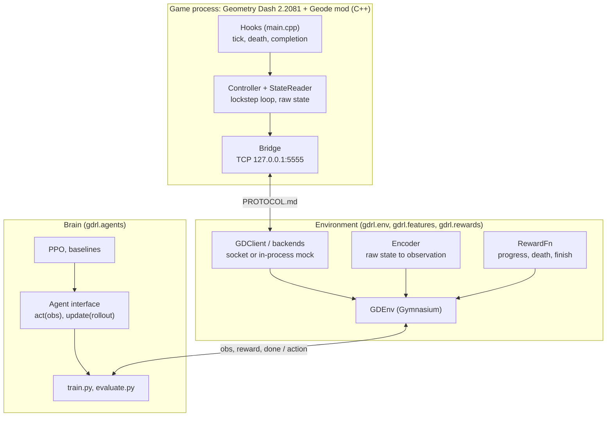

# geometry-dash-rl

A reinforcement-learning agent that learns to beat Geometry Dash levels. A Geode
mod turns the game into an environment server; a Python package with a
hand-written PPO in PyTorch learns to play it.

This repo is a learning project. The plumbing (sockets, framing, the mock game,
the train loop, logging) is done. The parts worth learning are left as
`LEARN(Mx)` stubs with docstrings, hints and tests that turn green when you
finish them. See [PROJECT_SUMMARY.md](PROJECT_SUMMARY.md) for results.

## Architecture



- **Dumb mod, smart Python.** The mod reports raw facts and applies a button
  state. Features, rewards and episode rules live in Python, so most changes
  need no C++ rebuild.
- **Python owns the clock.** The game advances only when a STEP arrives, by an
  exact number of physics ticks: reproducible runs, faster than real time.
- **One contract.** [protocol/PROTOCOL.md](protocol/PROTOCOL.md) defines every
  byte. The mod, the Python client and the mock server implement it.
- **One brain interface.** `train.py` only calls `act`, `update`, `save`, `load`.

## Layout

```
mod/                      Geode mod (C++), the environment server
  src/main.cpp            $modify hooks                         LEARN M0-M2
  src/StateReader.*       game -> proto::State                  LEARN M1
  src/Controller.*        handshake done; reset/step loop       LEARN M2-M3
  src/Bridge.*            TCP + framing (Winsock/POSIX)         done
  src/Protocol.hpp        packed structs, size asserts          done
  tools/                  Geode-free test server for the bridge done
protocol/PROTOCOL.md      the wire format
gdrl/                     Python package
  env/                    client, mock game + server, GDEnv, factory   done
  features/encoder.py     ObjectListEncoder, GridEncoder        LEARN M5
  rewards/reward.py       ProgressReward                        LEARN M5
  agents/base.py          Agent interface, Rollout              done
  agents/networks.py      layer_init, mlp, GridCNN              LEARN M6/M8
  agents/ppo.py           compute_gae, PPOAgent                 LEARN M6
  agents/baselines.py     RandomAgent done; rule, GA            LEARN M8
  tools/bridge_check.py   M3 gate checks for any server         done
  train.py, evaluate.py   loops, logging, checkpoints           done
configs/                  one YAML per experiment
levels.yaml               train vs. held-out levels
tests/                    plumbing tests (pass) + tests/learn (skip until you implement)
```

## Setup

### Python (any machine)

Python 3.12 is the target (3.10 to 3.14 work). On the RTX 4060 laptop, install
the CUDA build of PyTorch first, then the package:

```bash
python -m venv .venv
.venv\Scripts\activate                    # Windows; source .venv/bin/activate elsewhere
pip install torch==2.14.1 --index-url https://download.pytorch.org/whl/cu130
pip install -e ".[dev]"
python -c "import torch; print(torch.cuda.is_available())"   # expect True on the laptop
pytest
```

`pytest` should report everything passing except the `tests/learn` tests, which
show up as `SKIPPED ... TODO LEARN(Mx): ...` until you build them.

### The mod (Windows game PC)

Pinned versions: Geometry Dash 2.2081 (Steam), Geode 5.10.1.

1. Install Geode into the game from [geode-sdk.org/install](https://geode-sdk.org/install).
2. Toolchain, per [Geode's C++ tools page](https://docs.geode-sdk.org/getting-started/cpp-stuff):
   `scoop install llvm ninja`, Build Tools for Visual Studio 2022+ (MSVC Build
   Tools + Windows SDK), CMake 3.29+ and Git on PATH.
3. Install the [Geode CLI](https://docs.geode-sdk.org/getting-started/geode-cli),
   then `geode sdk install` and `geode sdk install-binaries`.
4. `cd mod && geode build`. The built `.geode` file installs itself into the game.

The mod code has not been compiled against the Geode SDK yet: getting it to
build and load is milestone M0. Expect small API fixes there (see the comments
in `main.cpp`).

## Running

```bash
# Everything without the game
pytest
python -m gdrl.train --config configs/mock_random.yaml     # smoke test the loop
tensorboard --logdir runs

# A fake game on a socket, to talk to with the client or bridge_check
python -m gdrl.env.mock_server --port 5555 --level 3
python -m gdrl.tools.bridge_check --port 5555

# The C++ bridge without GD (proves the structs match)
cmake -S mod/tools -B build/tools && cmake --build build/tools
build/tools/standalone_server 5555

# The real game, once the mod works (M3+): open your level in GD, then
python -m gdrl.tools.bridge_check --port 5555 --soak 10000   # the M3 gate
python -m gdrl.train --config configs/gd_ppo.yaml
python -m gdrl.evaluate --run runs/<run-folder> --sticky 0.1
```

Override any config value from the command line:
`--set seed=2 --set train.total_steps=50000 --set env.level_ids=[1,2]`.

## Conventions

- Units are game units: 30 per block. Coordinates in a `GameState` are absolute;
  encoders must make them relative to the player.
- Change the protocol in three places together (`PROTOCOL.md`, `Protocol.hpp`,
  `protocol.py`) and bump the version.
- Keep the bot offline, on your own unpublished levels.
