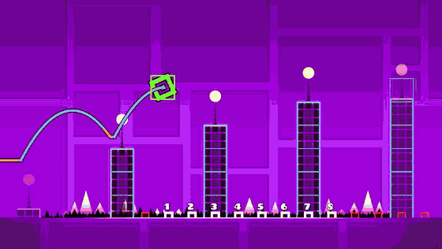
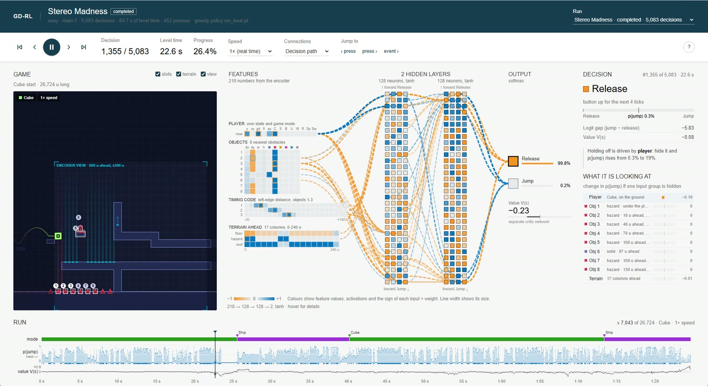
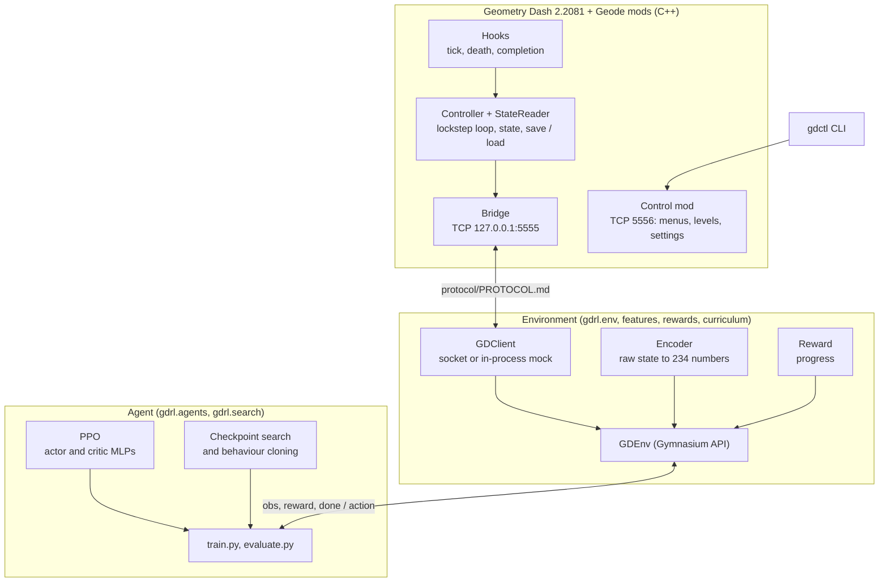

# geometry-dash-rl

A reinforcement-learning agent that plays Geometry Dash and has beaten three
levels from the level start, two of them extreme demons. A C++ Geode mod turns
the game into a lockstep environment; a Python package trains the agent with a
PPO written from scratch in PyTorch.

<!-- Video A. For an inline player on GitHub: edit this file on github.com, drag
     docs/media/stereo-madness-agent-view.mp4 into the editor, and put the
     github.com/user-attachments/... URL it inserts in place of this block. -->
<p align="center">
  <a href="docs/media/stereo-madness-agent-view.mp4">
    
  </a>
</p>
<p align="center">
  <b>Stereo Madness, completed by the trained policy in real time</b>
  (<a href="docs/media/stereo-madness-agent-view.mp4">full run, 87 s</a>).<br>
  Drawn into the game by the bridge mod: every hitbox the agent receives, the 8 objects its
  encoder looks at (numbered), the player's hitbox (green) and its path, blue while it holds
  the button and orange while it lets go.
</p>

## Inside the network

<!-- Video B. For an inline player on GitHub: drag docs/media/stereo-madness-network.mp4
     into the editor on github.com and put the github.com/user-attachments/... URL it
     inserts in place of this block. -->
<p align="center">
  <a href="docs/media/stereo-madness-network.mp4">
    
  </a>
</p>
<p align="center">
  <b>The same Stereo Madness run, replayed in the network visualizer</b>
  (<a href="docs/media/stereo-madness-network.mp4">full run, 87 s</a>).
</p>

This video starts and ends at the same moments as the gameplay video
above, so the two line up second for second. Pause it anywhere to read a single
decision. On the left is the game as the encoder sees it. In the middle are all
234 inputs, both hidden layers and the two outputs, with the strongest
input-times-weight connections drawn between them. On the right is the decision
and a knock-out test that names the input group driving it. Colours follow
TensorFlow Playground: orange is negative, blue is positive.

To explore it yourself, run `python -m gdrl.dashboard` and open
http://127.0.0.1:8050/viz, or open an exported `results/viz/<level>.html`. You
can step decision by decision, hover any neuron to see its inputs, and click
one to plot it over the whole run.

## Results

| Level | Difficulty | Result | How |
|---|---|---|---|
| Stereo Madness | Easy | Beaten, 3/3 greedy runs | PPO with a start-position curriculum (2.4 h, ~14k attempts) |
| Bloodbath | Extreme demon | Beaten, 3/3 greedy runs | PPO plus search-guided behaviour cloning (~299k attempts) |
| Rauchkammer | Extreme demon | Beaten, 3/3 greedy runs | Search-guided behaviour cloning (8.6 h) |
| GRIEF | Extreme demon | In progress: a route to 8.7% | Checkpoint search with 1-tick inputs |

Every run starts at the real level start, not a practice checkpoint. "Greedy"
means the policy always takes its more likely action.

## How it works



- **Lockstep game.** The bridge mod stops the game clock. Each STEP from
  Python runs an exact number of physics ticks and replies with the state, so
  runs are reproducible and train at about 970 steps a second on a laptop,
  roughly 16 times real time. The mod can also save and restore the whole game
  state in under a millisecond, which the search uses.
- **Environment.** A Gymnasium-style environment talks to the mod over a
  versioned TCP protocol. An encoder turns the raw state into 234 numbers
  measured from the player, and the reward is progress through the level.
- **PPO from scratch**, with separate actor and critic networks, checked on
  CartPole (500/500 on 3 seeds) and on a procedurally generated mock game.
- **Curriculum.** Episodes start from community "StartPos" copies of each level
  and from the agent's own saved states, so the hard sections get practice.
- **Search-guided behaviour cloning.** Where PPO stalled on the extreme demons,
  a beam search over saved game states found frame-precise routes through the
  hard sections. The routes are cloned into the policy, and a cloning anchor
  plus an "eval ratchet" keep later PPO training from forgetting them.

## How the network decides

The policy is a small MLP: 234 inputs, two hidden layers of 128 tanh neurons,
and two outputs, Release and Jump.

| Inputs | Count | What they describe |
|---|---|---|
| Player | 13 | height, vertical speed, on the ground, gravity, speed, game mode |
| Objects | 80 | the 8 nearest obstacles: offset, size and kind |
| Timing code | 66 | distance to the 3 nearest left edges, as Gaussian bumps |
| Terrain | 51 | 17 columns ahead: floor height, spikes on it, room overhead |
| Position | 24 | sin and cos of x, which let a policy learn a level's timing |

A softmax over the two outputs gives p(jump). The agent decides every 4
physics ticks (60 times a second) and holds the button when p(jump) is over
50%; in training it samples from the probabilities instead, which is how it
explores. A separate critic network of the same shape estimates the value of
each state for PPO. The timing code is what lets a network this small hit
jumps that are a few units wide: with raw distances alone it caught 7.5% of the
jumps a rule-based agent made, with the bumps 100%.

## Quick start

Requirements: Windows, Geometry Dash 2.2081 (Steam) with Geode 5.10 or newer, Python
3.10 to 3.14.

```powershell
python -m venv .venv
.venv\Scripts\activate
pip install torch==2.14.1 --index-url https://download.pytorch.org/whl/cu126
pip install -e ".[dev]"
pytest                                     # 173 tests, no game needed
```

Build and install the two mods (toolchain: LLVM/Clang, Ninja, CMake, Visual
Studio Build Tools, the Geode CLI and SDK, see
[Geode's setup guide](https://docs.geode-sdk.org/getting-started/cpp-stuff)):

```powershell
cd mod; geode build; cd ..                 # the bridge, port 5555
cd control-mod; geode build; cd ..         # the control port 5556 that gdctl uses
```

Train, watch and inspect:

```powershell
python -m gdrl.train --config configs/mock_ppo.yaml          # the mock game, no GD needed

python -m gdctl lock acquire                                 # the real game (see gdctl/README.md)
python -m gdctl prepare-training --level main:1
python -m gdrl.train --config configs/gd_sm_community.yaml
python -m gdrl.evaluate --run runs/<run folder>

python -m gdrl.tools.watch sm --hitboxes                     # watch a beaten policy at 1x, with its view drawn in
python -m gdrl.dashboard                                     # training dashboard on http://127.0.0.1:8050
python -m gdrl.tools.nn_trace record sm                      # trace a policy in game for the visualizer (/viz)
python -m gdrl.tools.nn_trace export results/viz/sm.trace.json.gz   # the visualizer as one offline HTML file
```

Any config value can be overridden on the command line, for example
`--set seed=2 --set train.total_steps=50000`.

## Repository layout

```
mod/                  Geode mod (C++): lockstep bridge, state reader, save/load, agent-view overlay
control-mod/          Geode mod: JSON control port (menus, levels, settings, screenshots)
gdctl/                command line that drives the game through the control mod
protocol/PROTOCOL.md  the wire format between the bridge and Python
gdrl/
  env/                TCP client, Gymnasium environment, mock game and server
  features/           encoders: object list with timing code and terrain profile; grid
  rewards/            progress reward
  agents/             PPO (actor and critic), networks, baselines
  search/             checkpoint search and distillation
  curriculum.py       practice starts from StartPos copies and saved states
  train.py            training loop; evaluate.py scores a run
  tools/              watch, nn_trace, demo_bc (behaviour cloning), search drivers, checks
  dashboard/          training dashboard (stdlib server, vanilla JS)
  visualizer/         network visualizer (vanilla JS, canvas)
configs/              one YAML per experiment; demos/ searched routes, starts/ practice starts
results/watch/        the beaten policies and their configs
results/viz/          recorded traces for the visualizer
docs/media/           the videos in this README
tests/                unit and integration tests
```

## Caveats

- Each policy is trained on one level. The results show that the pipeline can
  master a level, not general Geometry Dash skill.
- On the extreme demons the routes through the hardest sections came from
  search and were cloned into the policy; plain PPO stalled on Bloodbath and
  stayed at 0% on Rauchkammer. The cloned policies do not finish those levels
  when random action noise is added.
- The agent plays offline, against levels on this machine.

More detail: [PROJECT_SUMMARY.md](PROJECT_SUMMARY.md) for highlights, and
[gdctl/README.md](gdctl/README.md) and
[gdrl/dashboard/README.md](gdrl/dashboard/README.md) for the tools.
